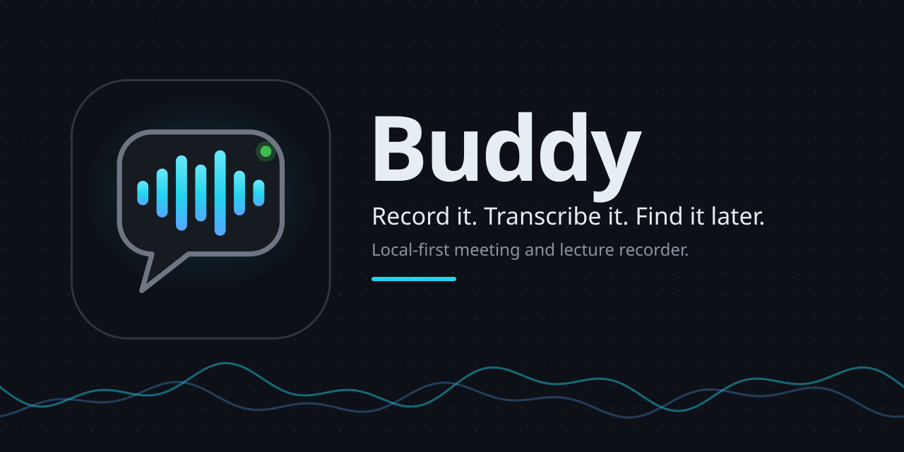
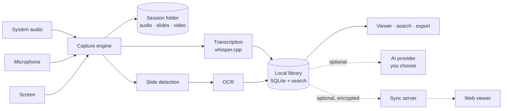

<div align="center">

<picture>
  <source media="(prefers-color-scheme: dark)" srcset="assets/banner-dark.svg">
  <source media="(prefers-color-scheme: light)" srcset="assets/banner-light.svg">
  
</picture>

<br>

[](LICENSE)
[](plan.md)
[](#platforms)
[](#tech-stack)
[](#privacy)

**Record it. Transcribe it. Find it later.**

[Plan](plan.md) · [Features](#features) · [How it works](#how-it-works) · [Roadmap](#roadmap) · [Contributing](#contributing)

</div>

---

> **Status: planning.** There is nothing to install yet. This README describes what Buddy is being built to do. Progress is tracked in [`plan.md`](plan.md).

## What is Buddy?

Buddy records meetings and lectures and turns them into something you can actually search. It captures **what was said** (system audio and your microphone, as separate tracks) and **what was shown** (slide screenshots and optional screen video), then builds a timestamped transcript, slide text, and a searchable library. All of it runs on your computer.

AI summaries, study notes, and Q&A are optional extras. They run on the AI provider you choose, and they never replace the original recording.

## Features

| | |
|---|---|
| 🎙️ **Two-track recording** | System audio and microphone captured separately on one synchronized timeline. Crash-safe, with recovery. |
| 🖼️ **Slides and video** | Detects slide changes and saves screenshots, or records low-fps screen video, or both. |
| 📝 **Live and final transcripts** | Local speech-to-text with a live preview while you record and a more accurate pass after. English and Hindi. |
| 🔎 **Search everything** | Full-text search across transcripts and slide text. Click a result to jump to that moment in the audio and slide. |
| 🧠 **Optional AI notes** | Summaries, action items, flashcards, and Q&A that cite timestamps. Use OpenCode, Claude Code, Ollama, LM Studio, or an API key. |
| 🔒 **Optional encrypted sync** | Read your notes from any device. End-to-end encrypted, so the server cannot read them. |
| 📦 **Yours to keep** | Export to Markdown and JSON. Back up and restore your whole library. |

### Lectures and meetings

| Lecture preset | Meeting preset |
|---|---|
| Sensitive slide detection | Tuned for screen-share noise |
| Study notes, key concepts, flashcards, quizzes | Decisions, action items, follow-ups |
| Topic outline with timestamps | Meeting summary |

## Principles

- **Capture comes first.** Nothing else can slow down or block recording.
- **Local by default.** With sync off, Buddy makes no network calls.
- **No nagging.** No sign-in wall, no pop-ups. Sync lives in Settings and nowhere else.
- **Evidence over AI.** Your audio, slides, and transcript are the source of truth. AI output is labelled and links back to them.
- **You approve what leaves your machine.** Before anything goes to an AI provider or the sync server, Buddy shows exactly what will be sent.

## How it works



1. **Record.** Buddy writes audio in small chunks as it goes, so a crash loses almost nothing.
2. **Transcribe.** A live preview appears while you record. After you stop, a final pass produces the real transcript.
3. **Capture slides.** Changed slides are saved as screenshots and OCR'd, then linked to the transcript.
4. **Browse.** Click any transcript line to hear that moment and see the slide on screen at the time.
5. **Ask (optional).** Run an AI task over the parts of the session you choose.
6. **Sync (optional).** Encrypted notes can follow you to the web.

## Privacy

- Recording starts only when you start it, and a recording indicator is always visible.
- Sync is **off** until you turn it on. Local use never needs an account.
- Synced data is **end-to-end encrypted**. The server stores ciphertext and cannot search or summarize it.
- Your encryption keys are protected by a vault passphrase and a recovery key. **If you lose both, synced data cannot be recovered.**
- API keys are kept in your operating system's credential store, never in exports.
- No telemetry.

> Recording other people may require their consent where you live. Buddy shows a notice on first run but does not provide legal advice.

## AI providers

Pick the one you like. You can switch per task.

| Provider | Notes |
|---|---|
| **Ollama** | Fully local models |
| **LM Studio** | Fully local models |
| **API key** | Any OpenAI-compatible endpoint |
| **OpenCode** | Experimental, opt-in |
| **Claude Code** | Experimental, opt-in |

## Platforms

Windows, macOS, and Linux (Wayland and X11), all from the start. System-audio and screen capture work differently on each, so each platform has its own backend behind a shared interface. Details and open questions are in [`plan.md`](plan.md#8-technology-and-platform-matrix).

## Tech stack

| Layer | Technology |
|---|---|
| Desktop | Tauri 2, Rust core |
| UI | React, TypeScript, Vite |
| Speech-to-text | whisper.cpp |
| OCR | Tesseract |
| Local storage | SQLite with FTS5 |
| Server | Node.js, TypeScript, MongoDB |
| Encryption | XChaCha20-Poly1305, Argon2id |

## Roadmap

| Stage | What you get |
|---|---|
| **MVP** | Record on all three OSes, live and final transcripts (English + Hindi), slides and video, OCR, search, export |
| **v1** | AI summaries and Q&A with your choice of provider |
| **v1.x** | Optional end-to-end encrypted sync and a web viewer |
| **Later** | Speaker identification, media sync, web editing, PDF export |

The full milestone breakdown, risks, and open questions are in [`plan.md`](plan.md).

## Repository layout

```text
buddy/
├── apps/desktop     Tauri app
├── apps/web         Web viewer
├── crates/          Rust core (capture, asr, vision, ocr, store, ai, sync)
├── packages/        Shared UI, schemas, crypto
├── server/          Sync API
├── docs/            Design docs
└── assets/          Logo set (generated by logo.py)
```

## Branding

The logo set is generated by [`logo.py`](logo.py): a speech bubble holding a waveform, in GitHub's dark and light palettes with a cyan accent.

```bash
python logo.py            # SVGs into ./assets
pip install cairosvg      # optional, for PNG export
python logo.py --png      # SVGs and PNGs
```

## Contributing

Buddy is at the planning stage. The most useful help right now is:

- Testing system-audio and screen-capture behavior on Windows, macOS, and Linux.
- Hindi and English audio samples with reference transcripts for accuracy testing.
- Reviewing the encryption design in [`plan.md`](plan.md#12-accounts-sync-and-e2ee).

Open an issue to start a conversation.

## License

[Apache-2.0](LICENSE)
